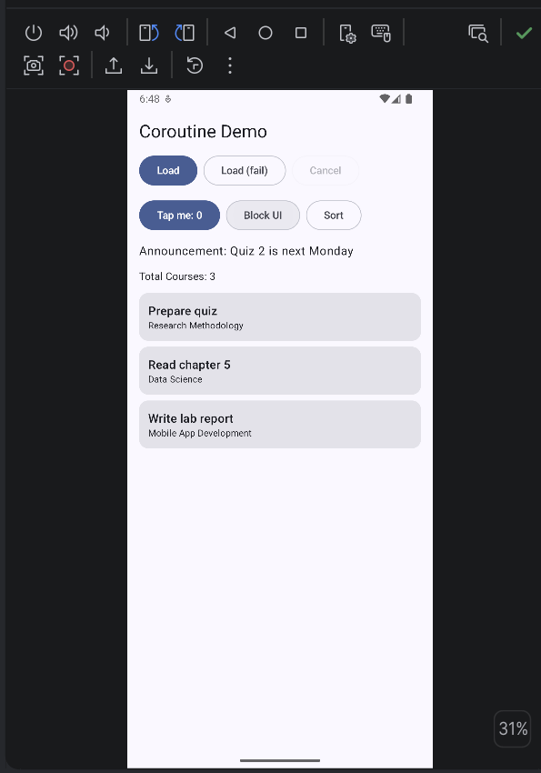

# Modul 17: Kotlin Coroutines & Asynchronous Programming

Aplikasi Android berbasis **Jetpack Compose** dan arsitektur **MVVM (Model-View-ViewModel)** yang mendemonstrasikan pemrograman asinkron menggunakan **Kotlin Coroutines** dan **StateFlow**.

Proyek ini dibuat untuk memenuhi tugas **Modul 17 - Kotlin Coroutines and Asynchronous Programming**, mencakup seluruh implementasi materi modul, penyelesaian **Latihan 9 (Soal 1–6)**, serta **modifikasi fitur mandiri**.

---

## 📱 Tangkapan Layar (Screenshot)

<p align="center">
  
</p>

---

## 🚀 Fitur Utama & Konsep Coroutine yang Diterapkan

1. **Pemuatan Konkuren Paralel (`async` & `await`)**
   * Mengambil data daftar tugas (2s), pengumuman (1s), dan jumlah mata kuliah (1.5s) secara bersamaan di `Dispatchers.IO`. Waktu tunggu total hanya ~2 detik (mengikuti tugas terlama).
2. **Uji Responsivitas UI (`Tap me`)**
   * Counter sentuhan tetap merespons seketika saat proses pemuatan berlangsung, membuktikan bahwa pekerjaan di *background thread* tidak memblokir *Main Thread*.
3. **Simulasi Main Thread Terhambat (`Block UI`)**
   * Contoh buruk yang disengaja menggunakan `Thread.sleep(3000L)` pada Main Thread untuk memperlihatkan efek *UI freeze* jika tidak menggunakan Coroutine.
4. **Pembatalan Pekerjaan (`Cancel`)**
   * Menghentikan proses pemuatan secara aman dan kooperatif dengan `Job.cancel()`.
5. **Penanganan Error Terstruktur & Tombol Retry (Latihan 9 No. 2)**
   * Menangkap kegagalan jaringan (`IOException`) dengan aman tanpa membuat aplikasi crash, lalu menampilkan pesan kesalahan dan tombol **Retry**.
6. **Pengurutan Data di Thread CPU (`Sort` - Latihan 9 No. 6)**
   * Mengurutkan daftar tugas berdasarkan judul secara komputasi di `Dispatchers.Default` dengan `withContext`.

---

## ✨ Modifikasi Fitur Mandiri: Real-Time Progress Bar (0% – 100%)

Sebagai bagian dari instruksi modifikasi/pengembangan bebas aplikasi:
* Mengganti indikator loading putar biasa menjadi **`LinearProgressIndicator`** horizontal yang menampilkan persentase unduhan secara dinamis (**0% hingga 100%**).
* **Konsep Coroutine:** Di dalam `coroutineScope`, dijalankan *child coroutine* (`launch`) yang mengalirkan pembaruan persentase setiap 20 milidetik (`delay(20L)`), selaras dengan waktu muat data 2 detik. Jika pemuatan dibatalkan, progress bar otomatis ikut berhenti seketika (*Structured Concurrency*).

---

## 📝 Pembahasan & Jawaban Latihan 9

### 1. Tambah Permintaan Ketiga (`getCourseCount()`)
* **Implementasi:** Fungsi `suspend fun getCourseCount(): Int` ditambahkan di `TaskRepository` dengan `delay(1500L)` dan dimuat bersamaan menggunakan `async` ketiga di ViewModel.
* **Analisis:** Waktu pemuatan total **tetap sekitar 2 detik**, karena ketiga fungsi berjalan secara konkuren di thread latar belakang. Waktu tunggu ditentukan oleh tugas terlama (`getTasks()` 2 detik), bukan penjumlahan ketiganya ($2 + 1 + 1.5 = 4.5$ detik).

### 2. Tombol Retry
* Tombol **Retry** muncul tepat di samping pesan kesalahan saat `errorMessage` tidak null dan langsung memanggil kembali `loadData()`.

### 3. Jebakan `catch (e: Exception)` vs `catch (e: IOException)`
* Ketika `catch (e: Exception)` digunakan dan tombol Cancel ditekan, pesan yang muncul adalah *"Failed to load: ... CancellationException"*.
* **Penyebab:** Pembatalan coroutine melempar `CancellationException`. Jika kita menangkap kelas umum `Exception`, pembatalan tersebut ikut tertangkap (tertelan) sehingga sistem salah mengartikan pembatalan normal sebagai kegagalan sistem.

### 4. `Thread.sleep` vs `delay` pada `withContext`
* **Dengan `withContext(Dispatchers.IO)`:** UI tetap lancar karena `Thread.sleep` hanya menidurkan thread pekerja IO di latar belakang.
* **Tanpa `withContext`:** UI macet total selama 2 detik karena `Thread.sleep` dieksekusi langsung pada Main Thread.

### 5. Pertanyaan Konsep
* **(a) Beda `launch` vs `async`:** `launch` berpola *fire-and-forget* (mengembalikan `Job` tanpa nilai balik), sedangkan `async` digunakan untuk mengambil nilai kembali (mengembalikan `Deferred<T>` yang diakses via `.await()`).
* **(b) Bahaya `GlobalScope`:** Tidak terikat dengan siklus hidup (*lifecycle*) komponen layar sehingga memicu kebocoran pekerjaan/memori (*memory leak*) ketika layar sudah ditutup.
* **(c) Structured Concurrency saat Child Gagal:** Jika `getTasks()` melempar exception di dalam `coroutineScope`, scope akan membatalkan *sibling coroutine* (`getAnnouncement()`), mencegah pekerjaan yang sia-sia di latar belakang.

### 6. Tantangan: Tombol Sort dengan `Dispatchers.Default`
* Pengurutan daftar tugas dijalankan pada *thread pool* CPU (`Dispatchers.Default`) menggunakan `withContext(Dispatchers.Default)`.

---

## 📂 Struktur Proyek

```text
com.example.modul17
├── data
│   ├── Task.kt               # Model data tugas
│   └── TaskRepository.kt     # Sumber data tiruan (suspend functions di Dispatchers.IO)
├── ui
│   ├── main
│   │   ├── TasksUiState.kt   # Immutable data class penampung seluruh state layar
│   │   ├── TasksViewModel.kt # Pengelola logika bisnis, coroutines, & StateFlow
│   │   └── TasksScreen.kt    # Tampilan UI deklaratif Jetpack Compose (Material 3)
│   └── theme                 # Konfigurasi Color, Type, dan Theme
└── MainActivity.kt           # Entry point aplikasi
```

---

## 🛠️ Teknologi yang Digunakan

* **Bahasa:** Kotlin 2.2.10
* **Toolkit UI:** Jetpack Compose (Material 3)
* **Arsitektur:** MVVM (Model-View-ViewModel)
* **Asynchronous:** Kotlin Coroutines (`viewModelScope`, `coroutineScope`, `async`, `launch`, `withContext`)
* **State Management:** Kotlin StateFlow & `collectAsStateWithLifecycle`
* **Build System:** Gradle Kotlin DSL (`build.gradle.kts`) & Version Catalog (`libs.versions.toml`)
* **Target SDK:** Android 37 (Minimum SDK 24)

---

## 🏃 Cara Menjalankan Proyek

1. *Clone* repository ini:
   ```bash
   git clone https://github.com/username-anda/Modul17.git
   ```
2. Buka folder proyek di **Android Studio**.
3. Tunggu proses **Gradle Sync** selesai.
4. Pilih target perangkat (**Android Emulator** atau perangkat fisik dengan USB Debugging aktif).
5. Klik tombol **Run** (`▶` atau `Shift + F10`).
